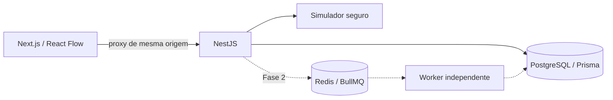

# Arquitetura

## Estado implementado em 20/10/2026

A fila padrão agora é PostgreSQL, na própria tabela `Execution`. Não depende de Redis/BullMQ. A API registra lead e execução `QUEUED` em uma transação e fixa `versionId` publicado; o worker reserva com `FOR UPDATE SKIP LOCKED`, lease e token de posse. API e worker usam `@eimax/workflow-runtime`, sem dois runners divergentes. `npm run dev` inicia também o worker; `RUN_WORKER=false` é reservado aos testes que controlam os processos concorrentes.

Os efeitos locais, etapas e conclusão são transacionais. O processador mantém lock da execução e do lead; uma reserva vencida não permite outro processador entrar enquanto a transação anterior está viva. Quedas desfazem efeitos não confirmados; a tentativa seguinte recupera o lease. Falhas transitórias de transação recebem backoff limitado. `attemptHistory` registra conclusão, retry e abandono. Esperas duráveis ainda não estão implementadas e falham explicitamente na produção; continuam instantâneas apenas no simulador.

Mensagens WhatsApp usam `Notification` como outbox, com unicidade por execução/bloco. O HTTP ocorre depois do commit. A reserva passa a `PROCESSING`; um ID do provedor confirma aceitação (`PENDING`) e não entrega. Webhooks autenticados e reconciliados atualizam `SENT`, `DELIVERED`, `READ` ou `FAILED`. Resultado incerto após interrupção exige reconciliação: não se reenvia automaticamente. Avisos internos ficam `AVAILABLE`. E-mail ainda não possui provedor e falha explicitamente. Logs históricos foram preservados; alegações antigas de entrega sem evidência passaram a `UNVERIFIED` para e-mails e `AVAILABLE` para avisos internos.

`@eimax/connectors` concentra criptografia AES-GCM, transporte HTTPS com origem autorizada, DNS IPv4 público fixado no socket, limite de resposta, timeout e rejeição de redirects. As conexões pertencem à organização; uma FK composta também protege a outbox contra conexão de outra empresa. O processamento de variáveis usa allowlists e referências anteriores, sem `eval`, com conteúdo dinâmico oculto no histórico.

Não há provedor WhatsApp disponível nesta entrega, conforme confirmado pelo usuário. A interface mantém **Configuração necessária**. Contratos testados com fixtures não constituem evidência de pareamento ou entrega. Consulte [operação e limites](operations.md) e o [relatório da implementação](implementation-report-2026-10-20.md).

As seções abaixo registram o plano original; propostas futuras não representam o estado implementado acima.

## Decisão

Monorepo npm, monólito modular com três processos: Next.js (interface), NestJS (API), worker BullMQ (fase 2). PostgreSQL/Prisma persiste os dados; Redis será a fila. Sem código arbitrário dos clientes. Os contratos Zod versionados são compartilhados entre cliente, API e simulador.

## Primeira fatia

- Abrir modelo SDR persistido, editar nós e arestas e salvar com revisão otimista.
- Estrutura do rascunho validada; configurações incompletas podem ser preservadas. Publicação/simulação exigem semântica completa.
- Publicação incrementa versão em transação, mantendo snapshots imutáveis.
- Simulação no servidor percorre o grafo com evento de exemplo, avalia condições e registra entradas/saídas redigidas. Nenhuma integração é chamada e o bloco esperar só descreve a espera.
- Simulações ficam persistidas; a UI destaca etapas e permite consultar seus resultados.
- Duas organizações de desenvolvimento, memberships owner/editor/viewer e sessões opacas locais. O servidor resolve organization_id pela membership da sessão e aplica escopo em leituras, escritas, versões e logs. O cliente não escolhe empresa por header/corpo/query. Leitores não escrevem/simulam; editores não publicam. Isolamento e RBAC estão cobertos por integração. Cadastro/login e sessões de produção permanecem na fase 3.
- API escuta apenas loopback e recusa iniciar sem DEVELOPMENT_WORKSPACE=true nesta fase. Escritas exigem origem local e header de cliente para impedir submissão cross-site simples. Não expor este ambiente na internet.

## Persistência

Organization, Membership, DevelopmentSession (token com hash SHA-256), Workflow (rascunho JSON, revisão), WorkflowVersion (snapshot imutável, unique workflow+version), Simulation (snapshot e logs JSON). organization_id em workflows/versões/simulações e chaves estrangeiras compostas impedem inconsistência de tenant. Trigger SQL impede UPDATE de versões publicadas, além da ausência de rota de atualização. Saves e publicações são transacionais. Migração SQL versionada. PostgreSQL local via embedded-postgres/pg_ctl para desenvolvimento em Windows sem Docker; Docker Compose para PostgreSQL/Redis também fornecido. Nenhum serviço/conta global instalado. Credenciais locais não são adequadas para produção.

## Próximas fases

Execuções reais terão Execution/StepLog/Outbox, constraint de idempotência por empresa+evento+versão, retries com backoff e checkpoints. Esperas serão jobs adiados, sem bloquear worker. Falhas entre envio e confirmação exigem idempotency key do provedor/outbox; não prometer exactly-once externo sem suporte do provedor.

Autenticação completa usará verificação de e-mail, CAPTCHA no servidor, CPF protegido por criptografia + hash de deduplicação e adapter de titularidade. A resolução local atual de memberships e RBAC será mantida nessa transição. Trial e quotas serão verificados na recepção e novamente pelo worker. Integrações terão segredos cifrados; HTTP externo limitado por allowlist, bloqueio de IPs privados/redirecionamentos e validação DNS para SSRF. Esses controles futuros não são alegados como concluídos.

## Fontes técnicas consultadas

- [React Flow: reconexão](https://reactflow.dev/examples/edges/reconnect-edge)
- [Next.js: instalação](https://nextjs.org/docs/app/getting-started/installation)
- [Prisma 6: generators](https://www.prisma.io/docs/orm/v6/prisma-schema/overview/generators)

Prisma 6.19.3 fixado para compatibilidade com Node 20.18 disponível; embedded-postgres é ferramenta de desenvolvimento, não infraestrutura de produção.
