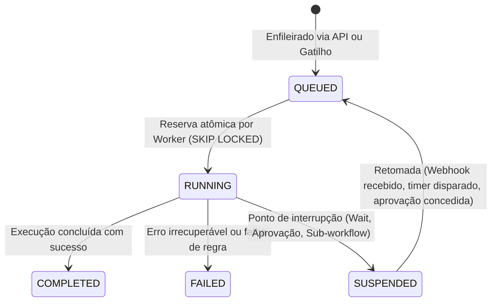
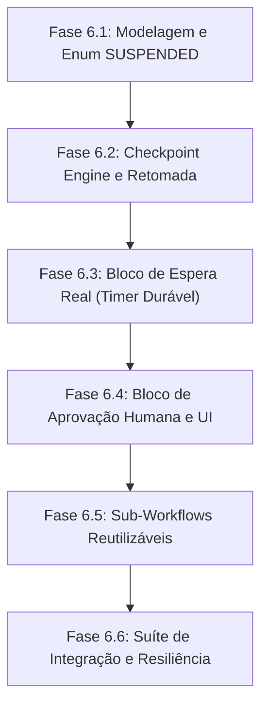

# Plano Técnico — Fase 6: Execução Assíncrona Durável, Suspensão e Intervenção Humana

## 1. Visão Geral e Objetivos

A Fase 5.2 garantiu a **imutabilidade estrita e integridade histórica** de versões publicadas de workflows (`WorkflowVersion`) e sua blindagem contra exclusão física direta, por cascata ou por comandos `TRUNCATE`.

A **Fase 6** evolui o motor de execução durável (`@eimax/workflow-engine` e `@eimax/workflow-runtime`) para suportar execuções de longa duração, permitindo que processos fiquem suspensos de forma segura aguardando eventos externos, tempos de espera reais ou aprovações humanas explícitas, sem manter conexões abertas ou locks em memória.

---

## 2. Diagnóstico Arquitetural e Contratos da Fase 6

### 2.1 Novo Status de Execução: `SUSPENDED`

Atualmente, `ExecutionStatus` no PostgreSQL e Prisma possui:
```prisma
enum ExecutionStatus {
  QUEUED
  RUNNING
  COMPLETED
  FAILED
}
```

Na Fase 6, o ciclo de vida da execução passa a admitir o estado `SUSPENDED`:
```prisma
enum ExecutionStatus {
  QUEUED
  RUNNING
  SUSPENDED    // Fase 6: aguardando evento externo, temporizador ou aprovação
  COMPLETED
  FAILED
}
```

#### Transições de Estado Autorizadas:


---

### 2.2 Checkpoints Persistentes e Estado Intermediário

Atualmente, cada etapa executada é persistida em `ExecutionStep`, mas o runner executa todos os blocos disponíveis em uma única transação/loop síncrono.
Para suspensão e retomada duráveis:
1. **Tabela `ExecutionCheckpoint`**:
   - `id`: UUID.
   - `executionId`: FK para `Execution` (`ON DELETE CASCADE`).
   - `organizationId`: Multi-tenancy isolado.
   - `nodeId`: ID do bloco onde a execução parou.
   - `state`: JSON contendo variáveis acumuladas, saídas de nós anteriores e pilha de contexto.
   - `resumeCondition`: Tipo de condição para retomada (`TIME`, `HUMAN_APPROVAL`, `SUB_WORKFLOW`, `EXTERNAL_EVENT`).
   - `expiresAt`: Timeout opcional para retomada automática ou expiração/falha.
   - `createdAt`, `updatedAt`.

2. **Garantia de Não-Regressão**:
   - O checkpoint é gravado atomicamente com a transição para `SUSPENDED` e liberação do lease (`leaseToken = null, leaseUntil = null`).

---

### 2.3 Retomada Durável de Workflows

- Quando a condição de retomada é satisfeita (ex: operador clica em "Aprovar", webhook de callback chega ou worker de timers detecta `expiresAt <= NOW()`):
  1. A `Execution` transita de `SUSPENDED` para `QUEUED`, com `availableAt = NOW()`.
  2. O worker de background reserva o job via `reserveExecution`.
  3. O runner recupera o `ExecutionCheckpoint` mais recente, restaura as variáveis resolvidas até o nó suspenso e continua a execução a partir do próximo nó conectado no grafo.
  4. Nenhum nó já executado antes do checkpoint tem seus efeitos colaterais reexecutados (idempotência intra-workflow).

---

### 2.4 Blocos de Aprovação Humana (`human.approval`)

1. **Configuração do Bloco**:
   - Papel ou membership elegível para aprovação (`eligibleRole: 'owner' | 'editor'`).
   - Título, descrição e dados do lead a serem apresentados para decisão.
   - Decisões possíveis: `APPROVED` (segue ramificação `true`) ou `REJECTED` (segue ramificação `false`).
   - Tempo limite (ex: 48 horas) e ação padrão em caso de timeout.

2. **Contrato de API**:
   - `GET /approvals/pending` — Lista aprovações pendentes para o usuário ativo da organização.
   - `POST /approvals/:id/decide` — Envia decisão (`APPROVED` / `REJECTED`) assinada pela sessão do operador, transacionando o checkpoint e enfileirando a retomada da execução.

---

### 2.5 Sub-Workflows Reutilizáveis (`workflow.call`)

1. **Definição**:
   - Permite que um workflow invoque outro workflow publicado da mesma organização.
   - A invocação vincula estritamente à versão publicada (`WorkflowVersion`) do sub-workflow no momento do disparo.
2. **Ciclo de Execução**:
   - O workflow pai entra em `SUSPENDED`, criando checkpoint com o ID da execução filha.
   - O sub-workflow executa como uma `Execution` independente vinculada à mesma organização.
   - Ao concluir, um gatilho/efeito transiciona o workflow pai de volta para `QUEUED`, injetando a saída do sub-workflow em seu contexto.

---

### 2.6 Recuperação após Reinicialização do Worker

- O mecanismo já existente na Fase 5.1/5.2 de lease de execução (`leaseUntil`, `SKIP LOCKED` e histórico de tentativas `ABANDONED`) é estendido:
  - Jobs `RUNNING` cujo worker caia têm seus leases expirados e são reatribuídos deterministicamente até `maxAttempts`.
  - Jobs `SUSPENDED` não possuem lease ativo; portanto, reinicializações de workers ou deploys de infraestrutura **não afetam** fluxos suspensos.

---

### 2.7 Preservação da Versão do Workflow Durante a Suspensão

- **Princípio Fundamental**: Uma execução suspensa **permanece eternamente vinculada à `WorkflowVersion` exata com a qual foi iniciada**.
- Mesmo que o workflow pai receba novas versões publicadas ou seja logicamente arquivado enquanto uma execução está `SUSPENDED`:
  - O campo `versionId` na `Execution` aponta para o snapshot imutável original.
  - A retomada lê exclusivamente o snapshot imutável associado a `versionId`.
  - A migração da Fase 5.2 (`ON DELETE RESTRICT` + triggers de imutabilidade) assegura que a versão nunca será apagada ou modificada durante a espera.

---

## 3. Plano de Implementação da Fase 6



> **Aviso de Escopo**: Nenhuma das alterações acima foi implementada nesta rodada. Este documento serve como especificação formal e preparação técnica para execução posterior autorizada.
