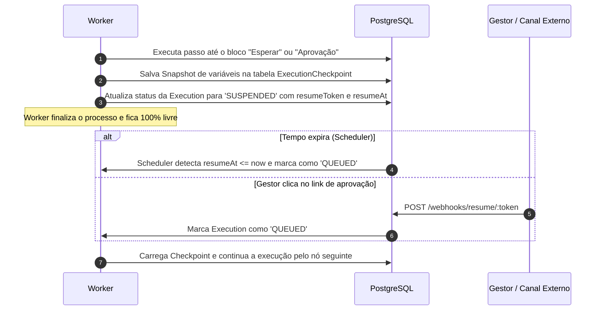

# Oportunidades de Evolução Arquitetural para a VEXOR

Este documento consolida as oportunidades de evolução técnica e de experiência do usuário identificadas a partir da investigação profunda de **Activepieces, WorkflowBuilder.io, n8n, Automatisch e Windmill**, estruturadas para transformar a VEXOR em um SaaS comercial de alto impacto, preservando sua fundação em **Next.js, NestJS, PostgreSQL e React Flow**.

---

## 1. Mapeamento Aprofundado das Oportunidades Técnicas

---

### Oportunidade 1: Fila Transacional Concorrente em PostgreSQL (`SKIP LOCKED`)
*Inspiração técnica: Windmill*

#### Desafio Atual
Atualmente, no protótipo da VEXOR, a execução assíncrona foi estruturada em `apps/worker` via polling simples. Em ambientes distribuídos de alta concorrência com múltiplos nós de worker, o polling ingênuo pode gerar conflitos de concorrência ou exigir a inclusão de um broker externo como Redis + BullMQ, aumentando a sobrecarga operacional em instalações locais e custos de infraestrutura.

#### Solução Técnica
Adotar o padrão arquitetural de **Fila Relacional com Lock Otimista/Pessimista Misto** utilizando a cláusula PostgreSQL:
```sql
SELECT * FROM "Execution"
WHERE "status" = 'QUEUED'
ORDER BY "createdAt" ASC
FOR UPDATE SKIP LOCKED
LIMIT 1;
```
- **Concorrência Atômica Sem Redis**: Múltiplos processos de workers (`apps/worker`) podem disputar tarefas na mesma tabela simultaneamente sem que dois workers recebam o mesmo job e sem que ocorram bloqueios em cascata (`deadlocks`).
- **Garantia Transacional ACID (Eliminação do Dual-Write)**: O recebimento do webhook/evento de lead e o enfileiramento da execução acontecem dentro da mesma transação SQL. Não há possibilidade de um lead ser salvo no banco sem que sua execução seja agendada.
- **Indexação Parcial para Performance**:
  ```sql
  CREATE INDEX "idx_execution_queued" ON "Execution" ("createdAt" ASC) WHERE "status" = 'QUEUED';
  ```
  Isso garante buscas em sub-milissegundos mesmo com milhões de execuções históricas concluídas na tabela.

---

### Oportunidade 2: Mapeamento de Variáveis por "Pílulas Visuais" e Template Engine Seguro
*Inspiração técnica: Activepieces e n8n*

#### Desafio Atual
Os blocos da VEXOR (`email.send`, `manager.notify`, `condition`) utilizam campos literais fixos ou selecionam uma única propriedade de um seletor estático. Em processos comerciais reais de SDR, os usuários precisam compor mensagens ricas combinando texto estático e dados dinâmicos do lead:
> *"Olá, **Marina**! Sou o SDR da **VEXOR** e vi que a **Acme Studio** possui interesse em automação comercial..."*

No n8n, isso exige conhecimento técnico de código ou sintaxe de template complexa (`{{ $json.name }}`), o que viola o objetivo de simplicidade da VEXOR.

#### Solução Técnica
1. **Componente de Pílulas Visuais no Inspetor**: No painel lateral do React Flow, os inputs de texto ganham um botão suspenso `"+ Inserir Variável"`. Ao clicar, uma lista categorizada de variáveis disponíveis do lead (`[Nome]`, `[E-mail]`, `[Empresa]`, `[Telefone]`, `[Orçamento]`) é exibida.
2. Ao selecionar, uma "pílula" visual estilizada é injetada no texto.
3. **Template Engine Seguro no Motor**: Em `@eimax/workflow-engine`, a interpolação ocorre através de um resolvedor seguro com regex estrito (ex: `{{lead.name}}`), sem invocar `eval` ou compiladores de código arbitrário. Variáveis ausentes recebem fallback seguro ou texto padrão.

---

### Oportunidade 3: Suspensão de Custo Zero (*Zero-Cost Suspension*) e Checkpointing de Estado
*Inspiração técnica: Windmill*

#### Desafio Atual
Automações comerciais exigem esperas de horas ou dias (ex: *"Aguardar 2 dias após o primeiro contato e verificar se o lead respondeu"*) ou aprovação manual de gerentes (ex: *"Aguardar o gestor aprovar a proposta antes de enviar o contrato"*). Manter workers travados em `sleep` ou `setTimeout` é inviável em produção (consome recursos, bloqueia escalonamento e perde estado se o contêiner reiniciar).

#### Solução Técnica
Adotar o padrão de **Suspensão de Custo Zero com Checkpoints Relacionais**:



1. **Tabela `ExecutionCheckpoint`**:
   - `id`: UUID
   - `executionId`: FK para `Execution`
   - `nodeId`: ID do nó que gerou a suspensão
   - `snapshot`: Dados do lead e saídas de todos os nós executados até o momento
   - `resumeToken`: Token opaco de segurança para aprovação externa
   - `resumeAt`: Timestamp opcional para expiração de esperas
2. **Desalocação Imediata**: O worker grava o checkpoint e encerra o processamento. Nenhuma memória é retida.
3. **Retomada Idempotente**: O motor lê o checkpoint e retoma a execução a partir do próximo nó da topologia.

---

### Oportunidade 4: Framework Modular de Conectores Tipados com Dropdowns Dinâmicos
*Inspiração técnica: Activepieces*

#### Desafio Atual
Para ser um SaaS comercial viável no ecossistema brasileiro de vendas e CRM, a VEXOR precisa se integrar facilmente a múltiplos serviços externos (WhatsApp/Evolution API, RD Station, HubSpot, Google Sheets, Pipedrive, Slack, E-mail transacional). Embutir essas chamadas diretamente no motor de execução geraria um código inchado e difícil de manter.

#### Solução Técnica
Criar o pacote modular `@eimax/connectors`:
- **Estrutura Declarativa**:
  ```typescript
  export interface ConnectorAction<TConfig, TOutput> {
    name: string;
    displayName: string;
    description: string;
    schema: z.ZodType<TConfig>;
    run: (context: { config: TConfig; lead: Lead; auth: any }) => Promise<TOutput>;
  }
  ```
- **Dynamic Dropdowns**: O conector pode expor métodos utilitários assíncronos (ex: `listFunnels`, `listSpreadsheets`) que a API do NestJS consulta para preencher menus no inspetor do React Flow, permitindo que o usuário selecione nomes amigáveis em vez de colar IDs técnicos.

---

### Oportunidade 5: Sub-Workflows e Módulos Reutilizáveis de Processo
*Inspiração técnica: n8n e Windmill*

#### Desafio Atual
À medida que os processos de uma empresa crescem, criar fluxos gigantescos no mesmo canvas polui a visualização, dificulta a manutenção e impede o reaproveitamento de rotinas padronizadas (ex: "Fluxo Padrão de Higienização de Lead", "Notificação Multicanal de Urgência").

#### Solução Técnica
- Criar o bloco **`workflow.call` (Chamar Sub-Processo)**.
- Ao adicionar esse bloco, o usuário seleciona um outro processo publicado da sua organização.
- O motor de execução `@eimax/workflow-engine` executa o sub-fluxo de forma encapsulada (com sua própria versão e isolamento de tenant), recebendo os dados do lead e retornando as variáveis atualizadas para o fluxo pai continuar.

---

### Oportunidade 6: Ergonomia Avançada do Canvas no React Flow
*Inspiração técnica: WorkflowBuilder.io*

#### Desafio Atual
A criação de fluxos em interfaces visuais pode se tornar frustrante se o usuário precisar realizar múltiplos cliques precisos para conectar alças ou se conexões erradas forem descobertas apenas na hora de simular.

#### Solução Técnica
1. **Snapping Magnético de Conexões**: Ao aproximar a linha de conexão de uma alça receptora (`target handle`), a aresta é atraída suavemente, facilitando a interação tanto no mouse quanto em touchpads de notebook.
2. **Validação Semântica em Tempo de Desenho**: Se o usuário tentar conectar uma saída a um bloco proibido (ex: ligar uma saída a um gatilho inicial ou conectar mais de uma saída em nós lineares), a aresta exibe feedback visual imediato em vermelho com cursor de impedimento.
3. **Mini-Toolbar Flutuante sobre o Nó Selecionado**: Barra rápida com ícones diretos: *Duplicar (Ctrl D)*, *Excluir (Del)*, *Testar Etapa* e *Configurar*.

---

### Oportunidade 7: Tratamento de Falhas Granular por Bloco e Fluxos de Erro
*Inspiração técnica: n8n e Activepieces*

#### Desafio Atual
Se uma API de envio de mensagem de WhatsApp ou e-mail falha momentaneamente por instabilidade do provedor, o fluxo inteiro atualmente para como `FAILED`.

#### Solução Técnica
1. **Configuração de Retry Automático com Backoff**: Cada bloco com chamada externa ganha configuração opcional:
   - *Tentativas de reenvio*: 1 a 5 vezes.
   - *Intervalo*: 5s, 30s, 2m, 10m.
2. **Política de Contingência (*Continue on Fail*)**: O usuário pode marcar um bloco como "Não interromper em caso de falha". Nesse caso, o bloco falha silenciosamente e o fluxo segue para um ramo alternativo ou para o próximo passo.
3. **Workflow de Erro Global**: Configurar um processo específico da empresa para ser acionado automaticamente caso ocorra falha irrecuperável em qualquer execução.

---

## 2. Matriz de Classificação das Oportunidades por Impacto Técnico

| Oportunidade | Impacto Técnico & Comercial | Complexidade | Compatibilidade Arquitetural | Prioridade Recomendada |
| :--- | :---: | :---: | :---: | :---: |
| **1. Fila Transacional em PostgreSQL (`SKIP LOCKED`)** | **Máximo** | Baixa | 100% (PostgreSQL existente) | **1º (Fase 4)** |
| **2. Pílulas Visuais e Template Engine Seguro** | **Máximo** | Baixa/Média | 100% (React Flow + Zod) | **2º (Fase 4)** |
| **3. Framework Modular de Conectores Tipados** | **Máximo** | Média | Alta (Monorepo TypeScript) | **3º (Fase 4)** |
| **4. Pausas Duráveis / Zero-Cost Suspension** | **Muito Alto** | Média | Alta (Tabelas PostgreSQL) | **4º (Fase 5)** |
| **5. Sub-Workflows Reutilizáveis** | **Alto** | Média | Alta (Engine atual) | **5º (Fase 5)** |
| **6. Ergonomia e Toolbar Flutuante no Canvas** | **Alto** | Baixa | 100% (React Flow puro) | **6º (Fase 5)** |
| **7. Retry com Backoff e Fluxos de Erro** | **Alto** | Média | Alta (Worker atual) | **7º (Fase 6)** |

---

## 3. Preservação da Arquitetura VEXOR

Todas as oportunidades mapeadas neste estudo:
- **Respeitam integralmente a pilha React 19 + Next.js 16 + React Flow 12** na camada de interface.
- **Mantêm o NestJS 11 modular** como backend soberano.
- **Mantêm o PostgreSQL 18 e o Prisma 6** como fonte única de dados, transações e filas, sem exigir a inclusão precoce de Redis.
- **Mantêm o isolamento estrito multi-tenant** por organização resolvido na sessão do servidor.
