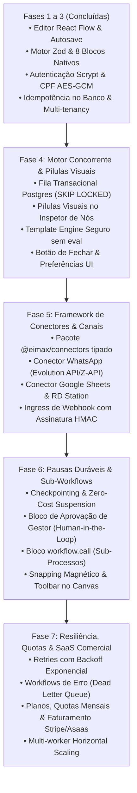

# Roadmap Técnico de Evolução e Integração — VEXOR SaaS

Este documento detalha o planejamento sequencial para transformar o protótipo atual da **VEXOR** em uma plataforma comercial robusta de automação de vendas e orquestração de processos, organizada em fases lógicas com objetivos, entregáveis e critérios claros de verificação.

---

## 1. Visão Sequencial das Fases de Evolução



---

## 2. Detalhamento Técnico das Fases

---

### Fase 4: Motor Concorrente em PostgreSQL e Pílulas Visuais de Variáveis

**Foco**: Escalabilidade da fila de execução assíncrona sem dependência externa de Redis e facilidade imediata para o usuário compor mensagens ricas.

#### Entregáveis:
1. **Fila de Execuções Concorrente com `SKIP LOCKED`**:
   - Criação de índice parcial no PostgreSQL:
     ```sql
     CREATE INDEX "Execution_queued_createdAt_idx" ON "Execution" ("createdAt" ASC) WHERE "status" = 'QUEUED';
     ```
   - Atualização do método de busca no worker (`apps/worker`) para utilizar transação com `SELECT ... FOR UPDATE SKIP LOCKED` e transição imediata para `RUNNING`.
   - Suporte nativo a múltiplos processos concorrentes de worker rodando simultaneamente sem conflito.
2. **Sistema de Pílulas Visuais de Variáveis no Inspetor do Canvas**:
   - Componente no painel de propriedades que permite inserir tags dinâmicas (`[Nome do Lead]`, `[E-mail]`, `[Empresa]`, `[Telefone]`, `[Orçamento]`) nos campos de texto.
   - Resolvedor em `@eimax/workflow-engine` que substitui de forma segura marcadores de interpolação pelos valores em tempo de execução, com proteção rigorosa contra injeção de código (`eval` é proibido).
3. **Persistência de Preferências e Ergonomia**:
   - Manutenção do fechamento e expansão de cards de dica no editor com memorização em `localStorage`.
   - Indicador visual em tempo real de campos obrigatórios não preenchidos no nó selecionado.

#### Verificação Técnica:
- Teste de integração de concorrência: 2 workers disputando 20 execuções enfileiradas simultaneamente, garantindo zero duplicações e zero execuções ignoradas.
- Testes unitários do template engine validando interpolação com strings maliciosas, caracteres especiais e chaves inexistentes.

---

### Fase 5: Framework de Conectores e Canais Críticos de Vendas

**Foco**: Permitir que a VEXOR atue diretamente nos canais de comunicação mais utilizados no mercado brasileiro de vendas (WhatsApp, CRM e Planilhas).

#### Entregáveis:
1. **Criação do Pacote `@eimax/connectors`**:
   - Arquitetura inspirada no *Pieces Framework* do Activepieces, com declaração padronizada de esquemas Zod para propriedades, autenticação e métodos de execução.
   - Módulo isolado de chamadas HTTP com proteção contra SSRF (bloqueio de IPs locais, verificação DNS e timeout estrito de 10s).
2. **Conector WhatsApp (Evolution API / Z-API / Gupshup)**:
   - Envio de mensagens de texto, botões e templates oficiais para prospecção ativa de SDR e confirmação de reuniões.
3. **Conector Google Sheets**:
   - Ação para anexar linha de lead qualificado e gatilho de leitura periódica de novas linhas.
4. **Conector RD Station / HubSpot / Webhook Genérico**:
   - Atualização de estágio de funil e tags no CRM do cliente.
   - Endpoint público de webhook com verificação de assinatura HMAC SHA-256 e deduplicação automática por `eventKey`.

#### Verificação Técnica:
- Testes unitários com mocks de API externa validando formato de payloads e tratamento de erros 4xx/5xx.
- Testes de segurança assegurando que credenciais de APIs (tokens de WhatsApp, API keys) continuem cifradas em repouso com AES-256-GCM.

---

### Fase 6: Pausas Duráveis (*Human-in-the-Loop*), Aprovações e Sub-Workflows

**Foco**: Automações de ciclo longo que aguardam dias ou aprovações humanas sem desperdício de recursos computacionais, e organização de processos complexos em sub-rotinas limpas.

#### Entregáveis:
1. **Zero-Cost Suspension e Checkpointing (Inspirado no Windmill)**:
   - Tabela `ExecutionCheckpoint` gravando snapshot de variáveis e outputs dos nós anteriores.
   - Status `SUSPENDED` no Prisma Client.
   - Liberação imediata do worker quando o fluxo atinge um bloco de espera ou aprovação.
   - Scheduler leve em `apps/worker` que verifica a cada 30 segundos checkpoints com data `resumeAt` expirada e os reenfileira como `QUEUED`.
2. **Bloco de Aprovação Humana (*manager.approve*)**:
   - Gera um link com token único assinado e envia para o gestor (via e-mail, Slack ou WhatsApp).
   - Endpoint `POST /webhooks/resume/:token` validando o token e retomando o fluxo para o ramo "Aprovado" ou "Rejeitado".
3. **Bloco `workflow.call` (Sub-Processos Reutilizáveis)**:
   - Permite que um fluxo execute outro processo modular da organização (ex: "Fluxo Padrão de Enriquecimento de Dados"), reduzindo nós duplicados no canvas.
4. **Ergonomia Avançada do Canvas (Inspirado no WorkflowBuilder.io)**:
   - Snapping magnético de arestas nas alças dos blocos.
   - Mini-toolbar contextual flutuante sobre o bloco selecionado.

#### Verificação Técnica:
- Teste de integração de ciclo de vida completo: fluxo inicia, atinge suspensão de 1 hora, grava checkpoint, libera worker e é retomado via webhook antes do tempo, concluindo com sucesso.

---

### Fase 7: Resiliência Avançada, Quotas e Monetização SaaS

**Foco**: Garantir alta confiabilidade contra instabilidades externas e estruturar o modelo de cobrança por uso da plataforma comercial.

#### Entregáveis:
1. **Política de Retries com Backoff Exponencial e Dead Letter Queue**:
   - Suporte a tentativas automáticas com jitter para chamadas HTTP de conectores externos.
   - Fluxo de contingência (*Error Workflow*) acionado automaticamente em falhas críticas.
2. **Gestão de Quotas e Limites de Uso**:
   - Controle mensal de execuções por organização (`executionsThisMonth`, `executionLimit`).
   - Bloqueio com aviso amigável quando a empresa ultrapassar o limite do plano contratado.
3. **Módulo de Faturamento e Assinaturas**:
   - Integração com Stripe / Asaas para gestão de assinaturas recorrentes e emissão de cobranças.
4. **Prontidão para Escala Horizontal**:
   - Configuração de múltiplos contêineres de workers processando a fila do PostgreSQL concorrentemente.
   - Suporte opcional ativável por variável de ambiente para Redis/BullMQ (`QUEUE_DRIVER=redis`) para clientes enterprise de hiperescala.

---

## 3. Matriz de Conectores Prioritários para o Mercado Comercial

| Conector | Tipo | Casos de Uso | Prioridade |
| :--- | :---: | :--- | :---: |
| **WhatsApp API (Evolution/Z-API)** | Ação | Mensagens automáticas de primeiro contato, lembrete de reuniões e follow-up | **P0 (Imediata)** |
| **Webhook Ingress Autenticado** | Gatilho | Recepção instantânea de leads de qualquer landing page, formulário ou app | **P0 (Imediata)** |
| **Google Sheets** | Gatilho/Ação | Leitura e inserção de leads em planilhas compartilhadas | **P0 (Imediata)** |
| **RD Station / HubSpot** | Ação | Envio de oportunidades qualificadas para o funil do CRM | **P1 (Fase 5)** |
| **E-mail Transacional (SMTP/Resend)**| Ação | Nutrição de leads com alta taxa de entrega e relatórios | **P1 (Fase 5)** |
| **Slack / Discord** | Ação | Notificação instantânea para canais internos da equipe comercial | **P2 (Fase 6)** |
| **Meta Ads (Leads Facebook/Insta)** | Gatilho | Captura direta de formulários nativos de anúncios pagos | **P2 (Fase 6)** |

---

## 4. Preservação de Princípios Arquiteturais

A execução deste roadmap preservará estritamente:
- **O editor React Flow (@xyflow/react)** como a base visual exclusiva da aplicação.
- **O PostgreSQL 18 como motor de dados e fila relacional ACID**, sem amarrações obrigatórias a brokers externos na instalação padrão.
- **O NestJS modular** com contratos estritos Zod e validação de segurança na API.
- **O isolamento multi-tenant intransigente**: nenhuma operação, conector, fila ou checkpoint poderá ser consultado ou executado sem resolução segura da `organization_id` da sessão no servidor.
