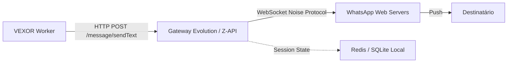
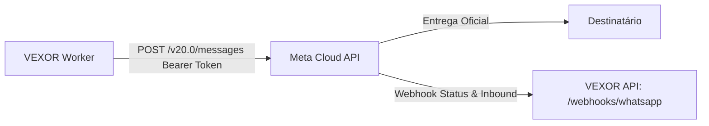

# Estudo Arquitetural: Integração de WhatsApp no VEXOR

## 1. Visão Geral e Contexto de Negócio

No mercado brasileiro e latino-americano, o WhatsApp é o canal prioritário para qualificação comercial de leads, atendimento ágil e engajamento pós-contato. Em operações de vendas (SDR/BDR), a velocidade de primeiro contato (*Speed to Lead*) reduzida para menos de 5 minutos pode multiplicar as taxas de conversão por até 5 vezes.

O objetivo deste documento é analisar tecnicamente as duas abordagens viáveis de integração de WhatsApp com a arquitetura do **VEXOR** (Next.js, NestJS, PostgreSQL, Prisma, Worker em Node.js), estabelecendo distinções rigorosas entre **Conexão via QR Code** e **API Oficial Meta**, sem contornar termos de serviço e definindo os padrões de segurança e idempotência exigidos pela plataforma.

---

## 2. Comparação Técnica: QR Code vs. API Oficial Meta

| Dimensão Técnica | Conexão via QR Code (Multi-Device) | API Oficial Meta (Cloud API / BSP) |
| :--- | :--- | :--- |
| **Protocolo Base** | WebSocket reverso emulando cliente WhatsApp Web (Noise Protocol) | REST API HTTPS direta com os datacenters da Meta (Graph API v20+) |
| **Provedores de Referência** | Evolution API, Z-API, Baileys, Wppconnect | Meta Cloud API direta, Twilio, Zenvia, Gupshup, Blip |
| **Infraestrutura Necessária** | Celular físico ou emulador com chip ativo conectado à internet | WhatsApp Business Account (WABA) + Número fixo/móvel homologado |
| **Verificação Empresarial** | Nenhuma (funciona com conta pessoal ou aplicativo WhatsApp Business) | Obrigatória (Verificação do Meta Business Manager com CNPJ e fatura) |
| **Custos Operacionais** | Apenas hospedagem do gateway (sem custo por mensagem da Meta) | Tarifação por conversa de 24h cobrada pela Meta + taxa do BSP |
| **Formato das Mensagens** | Texto livre, áudio, imagem e arquivos a qualquer momento | Fora da janela de 24h: **exclusivamente templates pré-aprovados (HSM)** |
| **Janela de Atendimento** | Irrestrita | 24 horas a partir da última mensagem enviada pelo lead |
| **Risco de Banimento** | **Elevado** se houver denúncias de spam ou envios em massa | **Zero** por protocolo (pode haver bloqueio apenas se violar diretrizes comerciais) |
| **SLA e Estabilidade** | Sem garantia; sujeito a desconexão de sessão e quedas de pareamento | 99,9% SLA garantido pelos servidores da Meta |
| **Conformidade Legal (LGPD)** | Questionável perante os termos da Meta | Total conformidade técnica e jurídica perante a Meta |

---

## 3. Análise Detalhada das Abordagens

### 3.1. Abordagem A: Conexão via QR Code (Multi-Device)

#### Arquitetura de Funcionamento
Um microserviço intermediário (como [Evolution API](https://github.com/EvolutionAPI/evolution-api) ou [Baileys](https://github.com/WhiskeySockets/Baileys)) roda em container Docker. Ele estabelece uma sessão de WhatsApp Web pareada via QR Code com o aplicativo instalado no smartphone do cliente.



#### Pontos Fortes
1. **Fricção de Entrada Quase Nula**: O cliente final abre o painel do VEXOR, escaneia o QR Code com seu WhatsApp e a integração está ativa em menos de 1 minuto.
2. **Ausência de Custos por Mensagem**: Ideal para pequenos negócios e operações com orçamentos restritos que não podem arcar com o custo por conversa da Meta.
3. **Flexibilidade de Conteúdo**: Envio imediato de mensagens sem necessidade de submissão e espera por aprovação de templates.

#### Riscos e Limitações
1. **Risco de Banimento do Número**: A Meta possui algoritmos heurísticos que detectam padrões de automação em contas conectadas via WhatsApp Web. Envios para números que não possuem o remetente salvo na agenda frequentemente resultam em banimento temporário ou permanente do chip.
2. **Queda de Sessão**: Atualizações no aplicativo do celular, reinicializações ou perda de conexão Wi-Fi podem derrubar a sessão do WhatsApp Web, exigindo novo escaneamento manual do QR Code.
3. **Impossibilidade de Escala Massiva**: Um único número conectado via QR Code opera com limites seguros de cerca de 10 a 20 mensagens por minuto para evitar flags de spam.

---

### 3.2. Abordagem B: API Oficial Meta (WhatsApp Cloud API & BSPs)

#### Arquitetura de Funcionamento
A comunicação é realizada diretamente via HTTPS contra o endpoint oficial `graph.facebook.com/v20.0/{phone-number-id}/messages`, autenticado via Bearer Token permanente (`System User Token`).



#### Modelo de Mensageria e Janela de 24 Horas
1. **Mensagens Ativas (Iniciadas pela Empresa)**:
   - A empresa **só pode iniciar uma conversa** utilizando um **Template HSM (Highly Structured Message)** previamente revisado e aprovado pela Meta.
   - Categorias de Templates:
     - `MARKETING`: Promoções, reengajamento comercial.
     - `UTILITY`: Notificações de status de pedido, alertas de agendamento, atualização de qualificação.
     - `AUTHENTICATION`: Códigos OTP de verificação em duas etapas.
2. **Janela de Sessão de 24 Horas**:
   - Quando o lead responde à mensagem ou envia uma mensagem espontânea, abre-se uma janela de 24 horas.
   - Dentro dessa janela, o VEXOR pode enviar mensagens de texto livre, botões interativos e arquivos sem necessidade de template aprovado.
3. **Webhook de Entrega e Leitura**:
   - A Meta envia webhooks assíncronos notificando cada transição de estado da mensagem: `sent` -> `delivered` -> `read` -> `failed`.

#### Pontos Fortes
1. **Confiabilidade Empresarial**: Infraestrutura global da Meta com alta taxa de entrega e zero risco de desconexão de sessão.
2. **Recursos Interativos Oficiais**: Suporte a botões de resposta rápida (`Quick Reply`), botões de ação com URL (`Call to Action`) e menus de lista (`List Messages`).
3. **Legalidade e Segurança**: Total conformidade com as diretrizes da Meta, viabilizando vendas para médias e grandes empresas corporativas.

#### Custos e Burocracia
- Requer CNPJ ativo, domínio institucional, verificação no Meta Business Manager e linha telefônica apta a receber SMS de confirmação.
- Tarifação por conversa (modelo de precificação oficial da Meta para o Brasil, com custos variáveis por categoria).

---

## 4. Design da Integração no VEXOR

### 4.1. Camada de Abstração: Interface `WhatsAppAdapter`

Para evitar acoplamento do motor de fluxos a um provedor específico, o VEXOR deve adotar o padrão **Adapter/Strategy**:

```typescript
export interface WhatsAppMessagePayload {
  to: string; // E.164 (+5511999999999)
  type: 'text' | 'template';
  text?: string;
  template?: {
    name: string;
    language: string;
    components?: Array<{
      type: 'header' | 'body' | 'button';
      parameters: Array<{ type: 'text' | 'currency' | 'date_time'; text?: string }>;
    }>;
  };
}

export interface WhatsAppSendResult {
  providerMessageId: string;
  status: 'PENDING' | 'SENT' | 'DELIVERED';
  costCurrency?: string;
  costAmount?: number;
}

export interface WhatsAppAdapter {
  sendMessage(payload: WhatsAppMessagePayload): Promise<WhatsAppSendResult>;
  verifyWebhook(hubMode: string, hubToken: string, hubChallenge: string): string | null;
  parseInboundEvent(body: unknown): {
    from: string;
    messageId: string;
    text?: string;
    timestamp: Date;
  } | null;
}
```

---

### 4.2. Extensão do Esquema de Blocos (`@eimax/workflow-schema`)

#### 1. Bloco de Ação: `whatsapp.send`
```typescript
catalog['whatsapp.send'] = {
  name: 'Enviar WhatsApp',
  description: 'Envie uma mensagem comercial direta ou notificação',
  category: 'Ações',
  color: 'emerald',
  defaults: {
    channelType: 'official', // 'official' | 'qrcode'
    templateName: 'qualificacao_comercial_v1',
    language: 'pt_BR',
    fallbackText: 'Olá! Recebemos seu interesse na nossa solução. Podemos conversar?',
  },
};
```

#### 2. Bloco Gatilho: `whatsapp.received`
```typescript
catalog['whatsapp.received'] = {
  name: 'WhatsApp Recebido',
  description: 'Inicie o fluxo quando um lead responder ou enviar mensagem',
  category: 'Gatilhos',
  color: 'emerald',
  defaults: {
    filterKeyword: '',
  },
};
```

---

### 4.3. Gerenciamento de Credenciais e Segurança

As credenciais de WhatsApp devem ser tratadas com o mesmo rigor de segurança implementado na Fase 3 do VEXOR (criptografia no banco de dados):

1. **Credencial Oficial Meta Cloud API**:
   - `phoneNumberId`: Identificador do número de telefone na Meta.
   - `wabaId`: WhatsApp Business Account ID.
   - `accessToken`: Token permanente de usuário do sistema da Meta (criptografado com AES-GCM 256-bit).
   - `webhookVerifyToken`: Token de validação de handshake do webhook.
2. **Credencial Conector QR Code**:
   - `instanceUrl`: Endpoint do gateway local ou gerenciado (ex: `https://evolution.empresa.com`).
   - `apiKey`: Chave de autenticação HTTP.
   - `instanceName`: Nome único da instância pareada.

---

### 4.4. Tratamento de Inbound e Handshake de Webhook

No controlador de entrada da API NestJS:

```typescript
@Get('webhooks/whatsapp/:workflowId')
@SetMetadata('public', true)
verifyWhatsAppWebhook(
  @Param('workflowId') workflowId: string,
  @Query('hub.mode') mode: string,
  @Query('hub.verify_token') token: string,
  @Query('hub.challenge') challenge: string,
) {
  // Valida o token cadastrado na configuração do bloco do workflow
  if (mode === 'subscribe' && token === expectedSecret) {
    return challenge;
  }
  throw new ForbiddenException('Token de verificação inválido.');
}
```

---

## 5. Matriz de Decisão e Roadmap Recomendado

### Recomendação Estratégica: Abordagem Híbrida em Duas Etapas

1. **Fase 1 (SaaS Enterprise & Comercial): Conector Oficial Meta Cloud API**
   - **Por que primeiro**: Garante estabilidade operacional para clientes que já faturam e precisam de garantia contra bloqueios. Cumpre integralmente os requisitos de conformidade corporativa.
   - **Mecanismo**: Integração direta com a Graph API da Meta, suportando templates HSM de qualificação comercial (`UTILITY` e `MARKETING`) e recepção via webhook oficial.

2. **Fase 2 (Adoção PME Acelerada): Driver Opcional QR Code (Evolution API)**
   - **Por que segundo**: Permite que pequenos clientes com apenas 1 chip testem a automação sem custo de mensagens Meta e sem esperar a verificação de CNPJ.
   - **Diretriz de Segurança**: Exibir aviso explícito na interface:
     > *"A conexão via QR Code utiliza o protocolo web do WhatsApp. Recomendada exclusivamente para atendimento receptivo ou baixo volume. Risco de banimento em caso de envio não solicitado."*

---

## 6. Conclusão

A VEXOR deve manter uma arquitetura agnóstica de canal através da interface `WhatsAppAdapter`. Isso assegura que o construtor visual de fluxos trate o WhatsApp como um bloco desacoplado, permitindo que a empresa escolha entre a **API Oficial Meta** (alta disponibilidade, escala e conformidade) e a **Conexão QR Code** (baixo custo inicial para validação rápida), sem comprometer a estabilidade do motor de execução central.
